

  </img>

<h1 align="center">gemby</h1>

  </img>
  <a href="https://github.com/AmbitiousJun/gemby/releases/latest"></img></a>
  </img>

  Un cliente minimalista para Emby en AndroidTV basado en los núcleos de reproducción MPV / Media3 / VLC

## Grupo de Chat

- QQ: `1040749206`

## Guía de Uso

1. Actualmente solo está adaptado para AndroidTV, aunque también se ha procurado que funcione correctamente en tabletas y emuladores. Sienten libres de reportar problemas en la sección de issues. Las actualizaciones son relajadas～
2. En cualquier pantalla (excepto la de reproducción), mantén presionado el botón de retroceso para volver rápidamente a la página principal.
3. En la pantalla de reproducción, las teclas de dirección arriba (↑) y abajo (↓) ajustan el volumen relativo.
4. En la pantalla de reproducción, las teclas de dirección izquierda (←) y derecha (→) permiten avanzar o retroceder rápidamente en la posición de reproducción.
5. En la pantalla de reproducción, tanto la tecla de menú como la de confirmar (OK) muestran el controlador. Presionar varias veces la tecla de confirmar cambia rápidamente la velocidad de reproducción (los valores de velocidad se pueden personalizar en la configuración).
6. En pantallas táctiles, mantener presionado, la tecla M del teclado o la tecla de menú del control remoto muestran el menú de tarjetas.

## Vista de Interfaz

### Página Principal

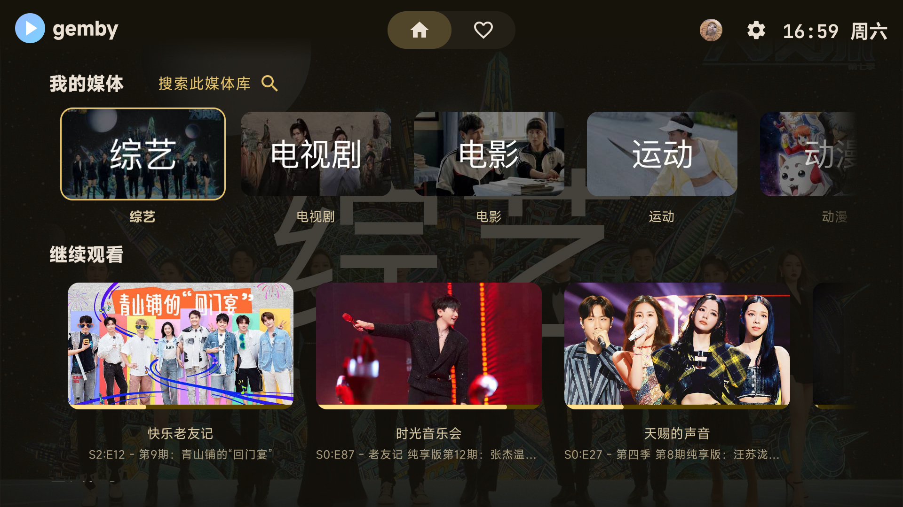

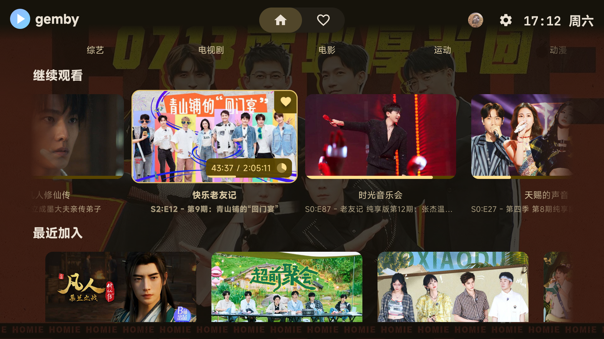

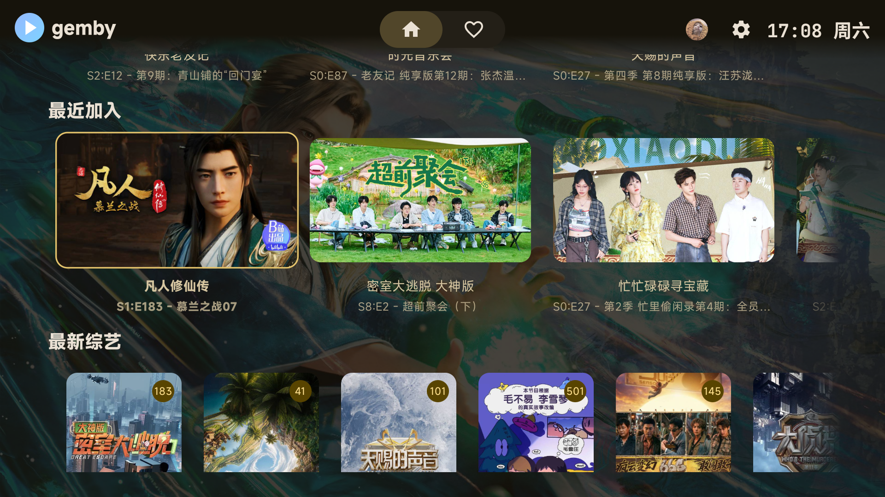

### Búsqueda

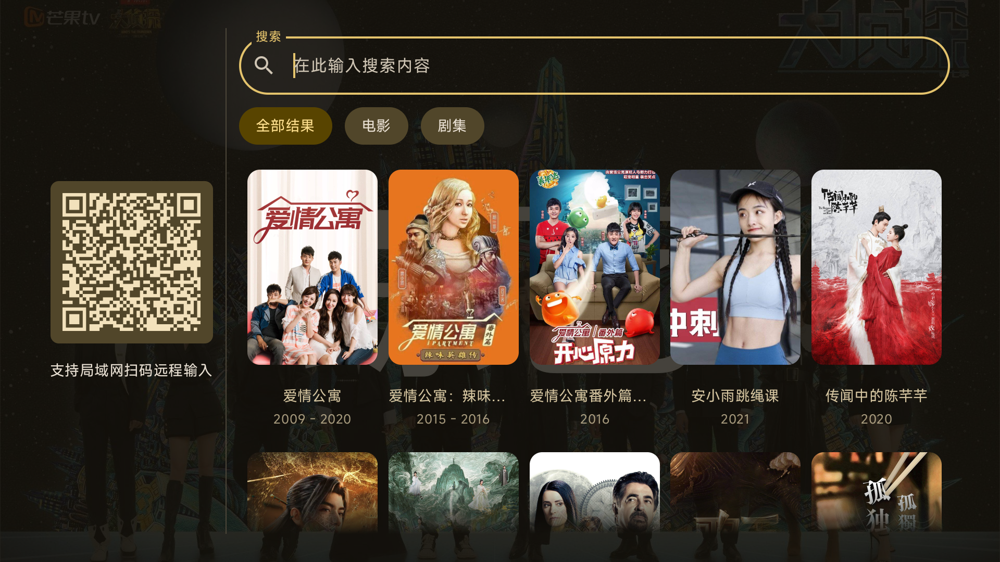

### Detalles de la Biblioteca Multimedia

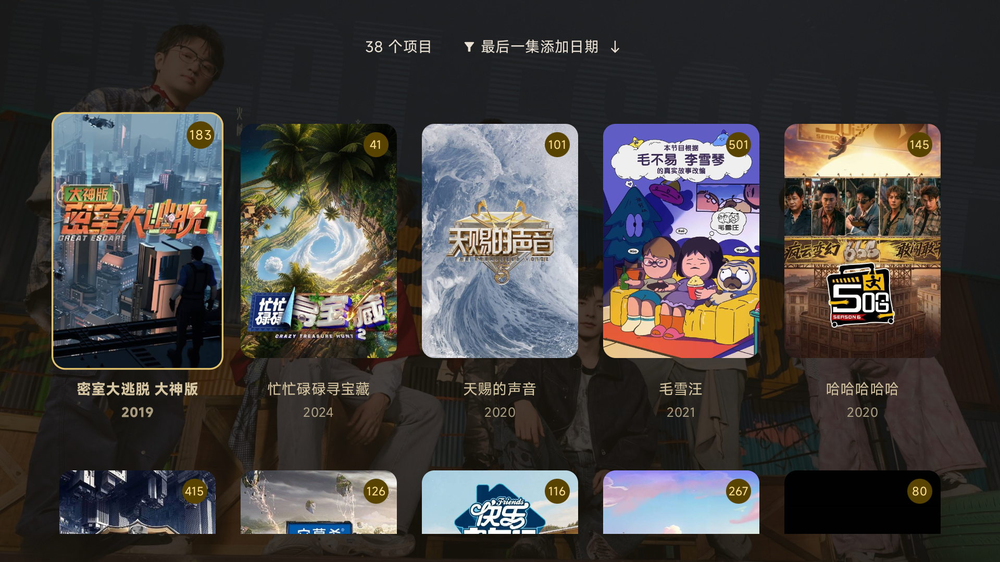

### Detalles de la Serie Favorita

### Página de Configuración

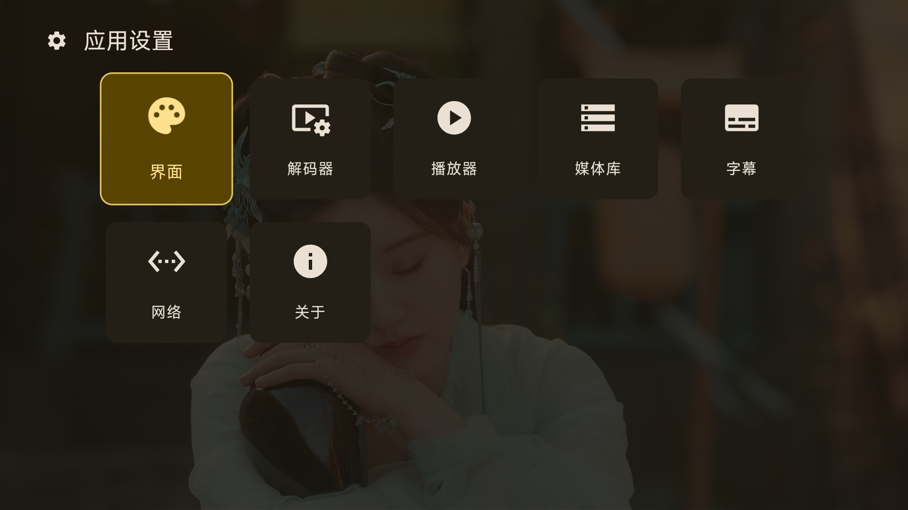

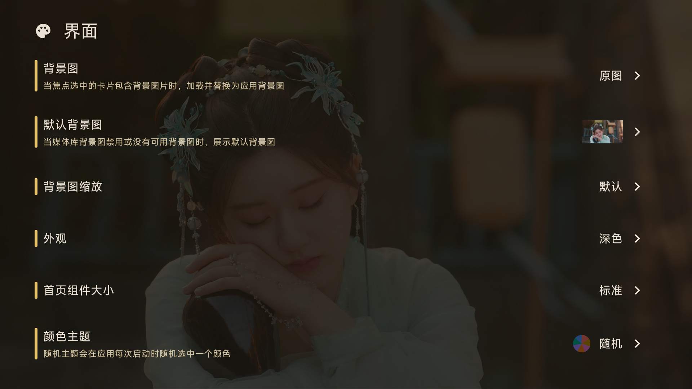

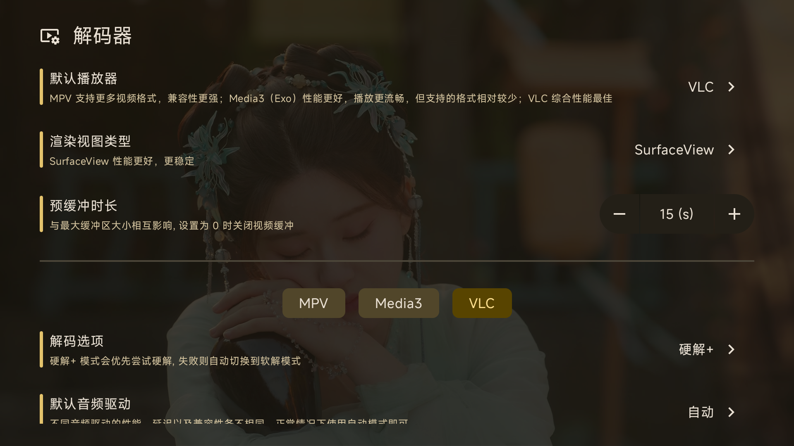

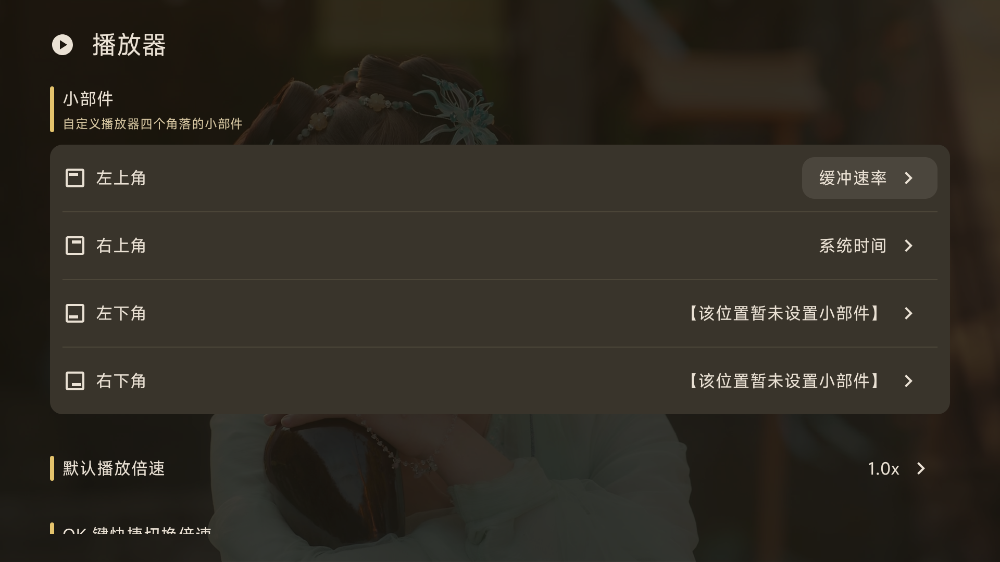

### Conexión a la Biblioteca Multimedia

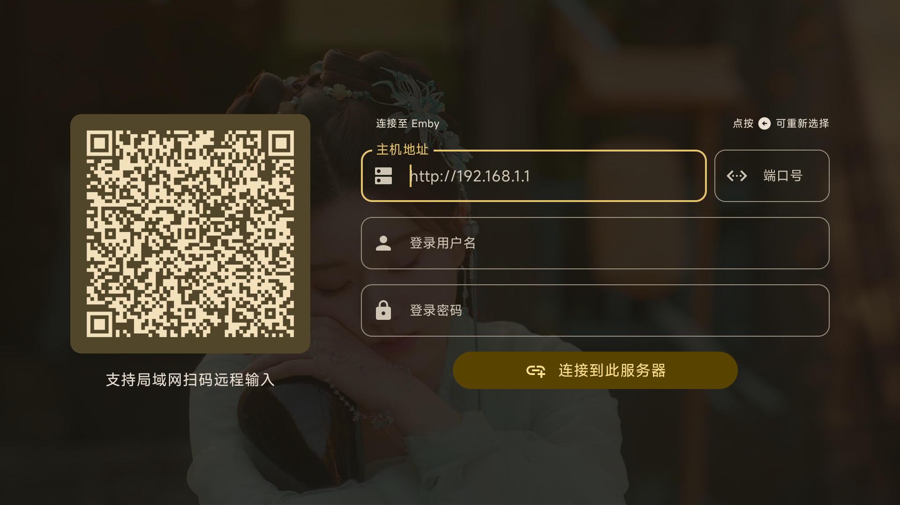

### Lista de Episodios

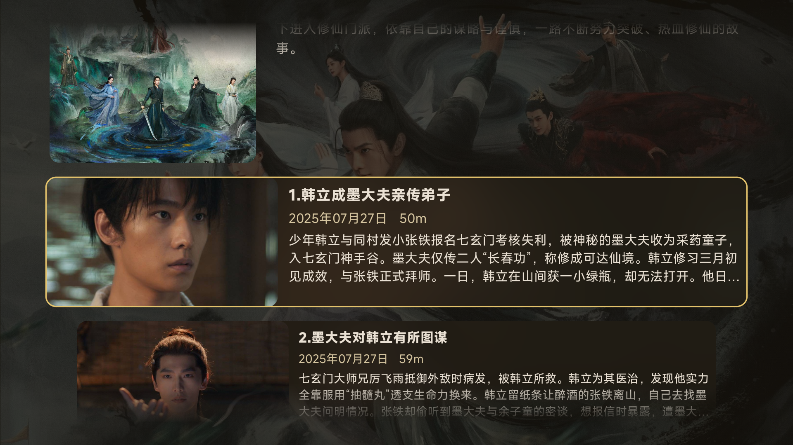

### Detalles de la Serie

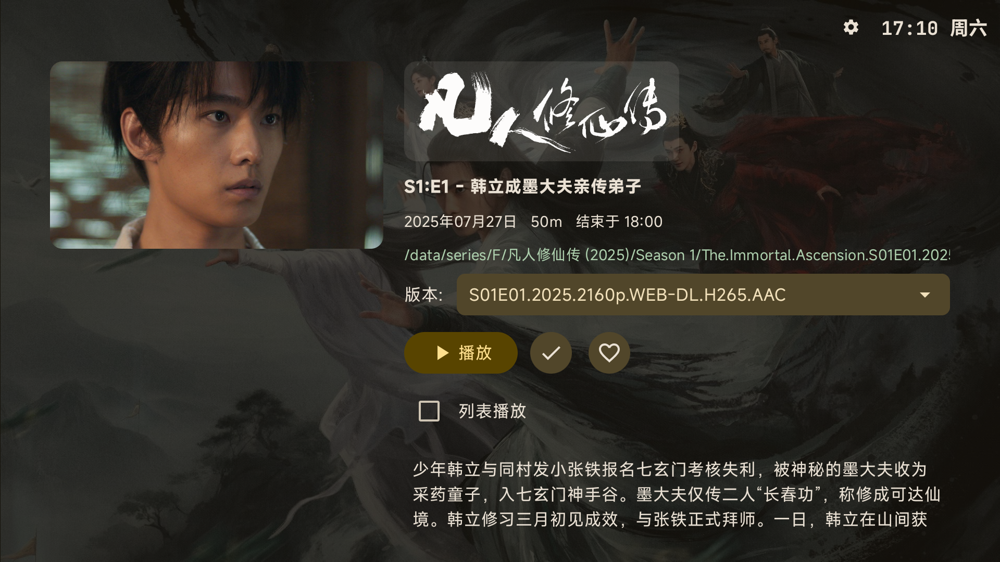

### Pantalla de Reproducción

## Invítame un café Luckin por 9.9💰 ☕️

</img>

## Historial de Estrellas

<a href="https://star-history.com/#AmbitiousJun/gemby&Date">

 <picture>
   <source media="(prefers-color-scheme: dark)" srcset="https://api.star-history.com/svg?repos=AmbitiousJun/gemby&type=Date&theme=dark" />
   <source media="(prefers-color-scheme: light)" srcset="https://api.star-history.com/svg?repos=AmbitiousJun/gemby&type=Date" />
   
 </picture>

</a>
