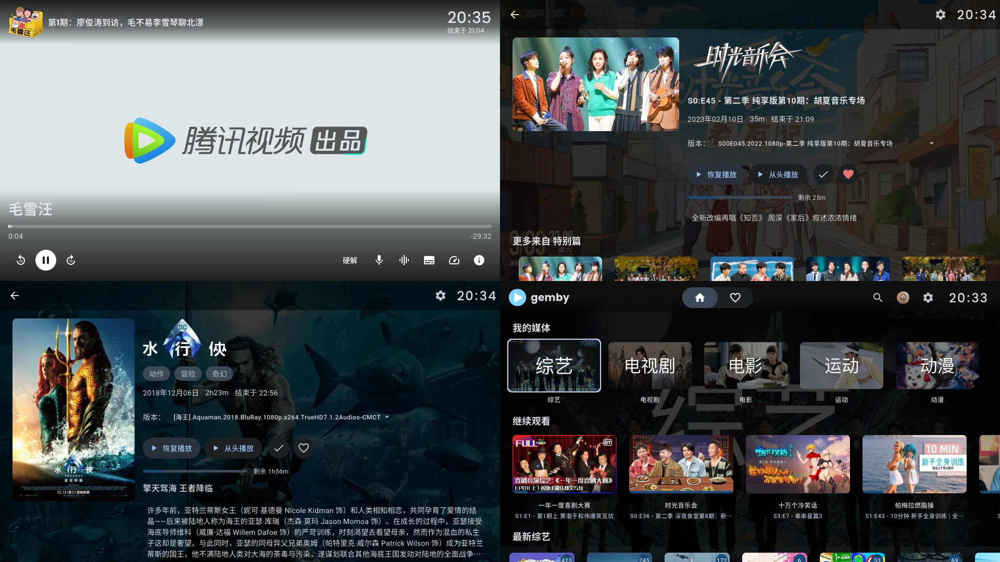

  </img>

<h1 align="center">gemby</h1>

  </img>
  <a href="https://github.com/AmbitiousJun/gemby/releases/latest"></img></a>
  </img>

  一个基于 MPV 内核的简约 Emby AndroidTV 客户端

## 界面展示

  </img>

## 交流群

- QQ: `1040749206`

## 使用说明

1. 目前只适配 AndroidTV，同时尽量让平板/模拟器也能够正常使用，欢迎 issue 区反馈问题，佛系更新～
2. 任意界面（播放页除外）长按返回键可快速退回首页
3. 播放页中，方向键上 (↑)、下 (↓) 可调节相对音量
4. 播放页中，方向键左 (←)、右 (→) 可快速跳转播放位置
5. 播放页中，菜单键和确认 (OK) 键均可唤出控制器，连按确认键可快捷切换倍速（可在设置中自定义修改倍速值）
6. 触摸屏长按、键盘 M 键、遥控器菜单键均可唤出卡片菜单

## 请我喝杯 9.9💰 的 Luckin Coffee☕️

</img>

## Star History

<a href="https://star-history.com/#AmbitiousJun/gemby&Date">

 <picture>
   <source media="(prefers-color-scheme: dark)" srcset="https://api.star-history.com/svg?repos=AmbitiousJun/gemby&type=Date&theme=dark" />
   <source media="(prefers-color-scheme: light)" srcset="https://api.star-history.com/svg?repos=AmbitiousJun/gemby&type=Date" />
   
 </picture>
 
</a>
